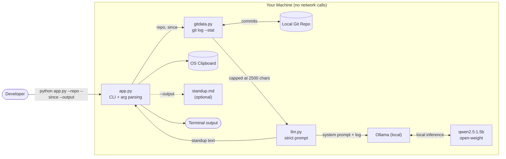

# Git Standup Sloth

A local CLI that reads your recent git commits and writes your standup,
using an open-weight model running entirely on your machine.

<div align="center">
  <a href="https://www.youtube.com/watch?v=reR8oLTXelM">
    
  </a>
  <br><br>
  <a href="https://www.youtube.com/watch?v=reR8oLTXelM">
    
  </a>
</div>

## Why

Standup is 5-10 minutes of staring at `git log` every morning. A standup
also describes private work — client repos, internal paths, unreleased
features. This tool sends nothing over the network: the model is
open-weight and runs locally via Ollama.

## Screenshot


## System Architecture



## Setup

1. Install [Ollama](https://ollama.com/download)
2. `ollama pull qwen2.5:1.5b`
3. `pip install -r requirements.txt`

## Usage

```bash
python app.py                          # last 24h in current repo
python app.py --repo ../other-project  # specific repo
python app.py --since "1 week ago"     # weekly recap
python app.py --output standup.md      # save to file
```

Output is printed to the terminal and copied to your clipboard.

## How it works

`git log --stat` → strict prompt → `qwen2.5:1.5b` via Ollama → standup.

No API keys. No cloud. No data leaves your machine.

## Limitations

- 1.5B model can duplicate bullets and paraphrase loosely.
- Reads commit messages + diff stats only, not diff contents.
- Prompt is capped at 2,500 chars to keep the small model focused.

## Built with


> **Built with an open-weight model for the Hacktoberfest Open-Source AI Challenge: Week 3.**